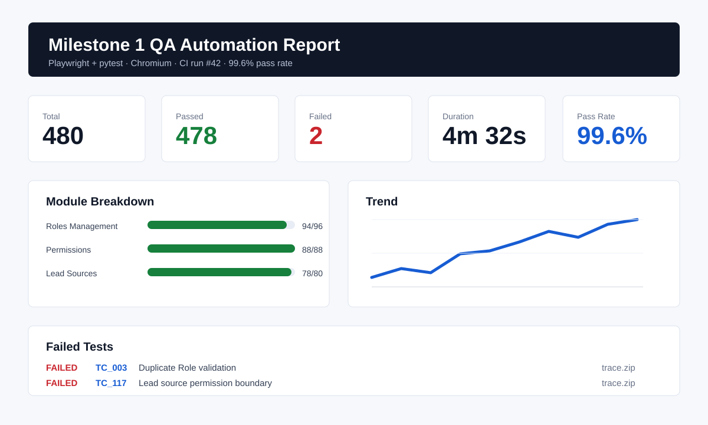

# Playwright + pytest QA Skill

Reusable Codex skill for creating professional QA automation suites with
Playwright and pytest.

Current version: `v1.1.0`

The downloadable file is:

```text
playwright-pytest-qa.skill
```

## What It Does

This skill guides Codex through a complete end-to-end QA automation workflow:

- Set up a Playwright + pytest project structure
- Write UI and API test cases using Page Object Model patterns
- Track test-created data and clean it up automatically after each run
- Add a live Rich terminal progress display while tests execute
- Generate manager/client-friendly HTML test reports
- Preserve failure screenshots, videos, and Playwright traces
- Add enterprise practices for retries, CI/CD, visual regression, trace debugging,
  and API mocking

It is intended for staging QA automation where tests may create roles, users,
leads, teams, projects, master data, or similar records that must not build up
over time.

## When To Use It

Use this skill when asking Codex to:

- Write Playwright test cases
- Automate UI test flows
- Build pytest fixtures for browser or API testing
- Create Page Object Model files
- Add cleanup after tests create data
- Generate QA reports for test runs
- Improve terminal output for large test suites
- Add CI/CD execution, flaky test handling, visual comparisons, or API mocks

## Install

### Option 1: Install the `.skill` file

Download `playwright-pytest-qa.skill`, then install it into your Codex skills
folder using your Codex skill installation flow.

After installation, the skill name is:

```text
playwright-pytest-qa
```

### Option 2: Install from the folder

Copy the `playwright-pytest-qa/` folder into your Codex skills directory.

The folder contains:

```text
playwright-pytest-qa/
├── SKILL.md
└── references/
    ├── cleanup.md
    ├── terminal.md
    ├── report.md
    ├── flakiness.md
    ├── cicd.md
    ├── visual-regression.md
    └── api-mocking.md
```

## Repository Layout

```text
playwright-pytest-qa-skill/
├── README.md
├── LICENSE
├── CHANGELOG.md
├── requirements.txt
├── playwright-pytest-qa.skill
├── docs/
│   └── sample-html-report-preview.svg
├── examples/
│   └── sample-terminal-output.txt
└── playwright-pytest-qa/
    ├── SKILL.md
    └── references/
        ├── cleanup.md
        ├── terminal.md
        ├── report.md
        ├── flakiness.md
        ├── cicd.md
        ├── visual-regression.md
        └── api-mocking.md
```

## Skill Contents

`SKILL.md` contains the main workflow:

- Project setup
- Dependencies
- `pytest.ini`
- `config/config.py`
- Page Object Model conventions
- Test writing patterns
- Cleanup fixture wiring
- Live terminal plugin wiring
- HTML report plugin wiring
- Enterprise readiness guidance
- Common commands

The `references/` folder contains implementation details:

- `cleanup.md`: cleanup registry and cleanup API client
- `terminal.md`: Rich-based live pytest terminal plugin
- `report.md`: HTML report generation behavior and setup notes
- `flakiness.md`: retry policy, flaky test quarantine, and stabilization rules
- `cicd.md`: GitHub Actions workflow and CI artifact handling
- `visual-regression.md`: Playwright screenshot comparison strategy
- `api-mocking.md`: `page.route()` patterns for frontend-only states

## Quick Dependencies

The generated QA framework uses:

```text
playwright>=1.44.0
pytest>=8.0.0
pytest-playwright>=0.5.0
pytest-xdist>=3.5.0
pytest-rerunfailures>=14.0
python-dotenv>=1.0.0
requests>=2.31.0
faker>=24.0.0
rich>=13.0.0
```

These are also listed in `requirements.txt`.

## Enterprise Readiness

The skill now includes production-suite guidance for:

- Flaky test retries with `pytest-rerunfailures`
- GitHub Actions CI/CD execution
- CI artifact upload for reports, screenshots, videos, and traces
- Playwright trace viewer debugging
- Visual regression testing with screenshot baselines
- API mocking with `page.route()`

## Output Preview

Sample Rich-style terminal output:

```text
Lead Management - Milestone 1   480 tests collected

  1/480  [#-------------------]  PASS  TC_001  Create Role Valid        Roles Mgmt   0.82s   PASSED
  2/480  [##------------------]  PASS  TC_002  Role Name Mandatory      Roles Mgmt   1.10s   PASSED
  3/480  [###-----------------]  FAIL  TC_003  Duplicate Role           Roles Mgmt   1.55s   FAILED

  -- 5 run · 4 passed · 1 failed · 0 skipped · 80% pass rate · 12s elapsed --
```

Sample HTML report preview:



Full sample terminal output is available in `examples/sample-terminal-output.txt`.

## Versioning

Use semantic versioning for releases:

```text
v1.0.0 - initial public release
v1.1.0 - enterprise readiness update
```

Attach `playwright-pytest-qa.skill` to each GitHub Release so users can download a stable version.
Changes are tracked in `CHANGELOG.md`.

## Typical Prompt Examples

```text
Write Playwright pytest test cases for the role management module.
```

```text
Create a pytest automation framework with cleanup so staging data is deleted.
```

```text
Add HTML reporting and live terminal output to my Playwright tests.
```

```text
Add CI/CD, flaky test retries, and trace debugging to my Playwright pytest suite.
```

```text
Write visual regression tests and API mocks for frontend states.
```

## Notes

- Update API cleanup paths in `RESOURCE_DELETE_PATHS` to match your application.
- Store credentials and base URLs in `.env`; do not hardcode secrets in tests.
- Prefer stable selectors such as `data-testid`, IDs, ARIA labels, and names.
- Call `track("resource_type", id)` immediately after creating test data.
- Use the clean GitHub repo name `playwright-pytest-qa-skill` for public sharing.
